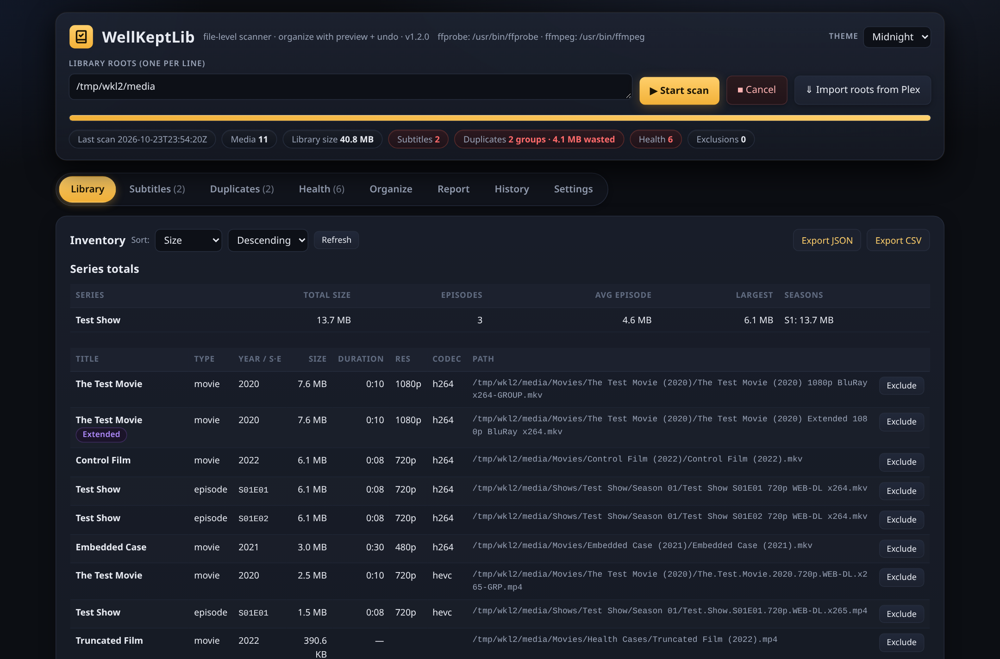
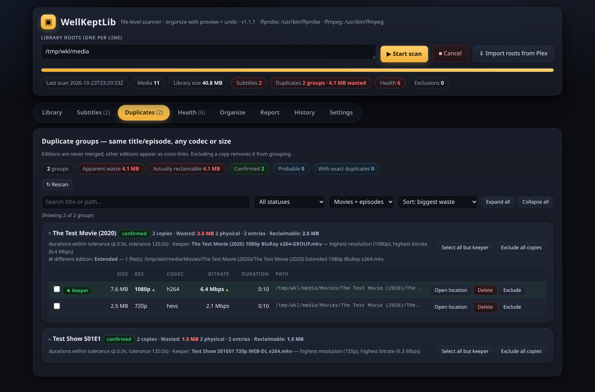
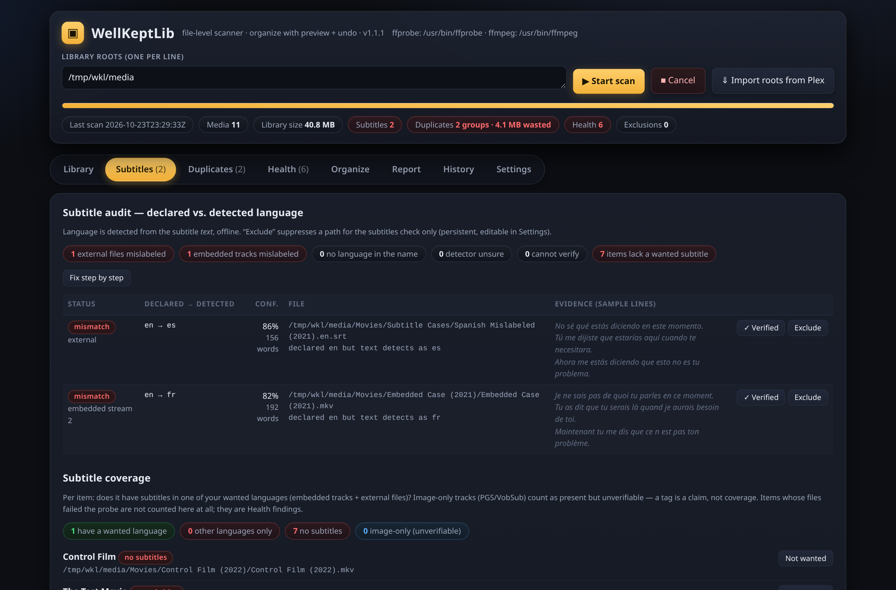
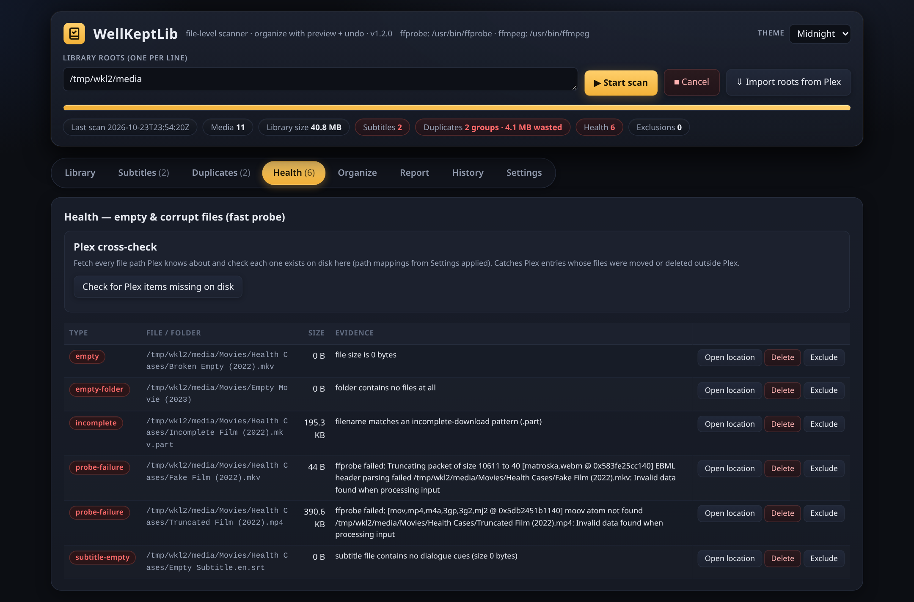
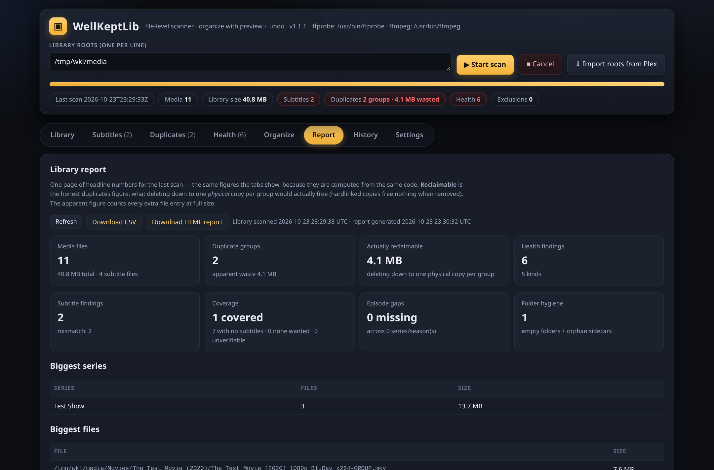
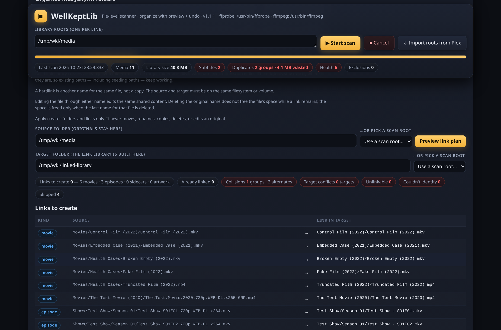
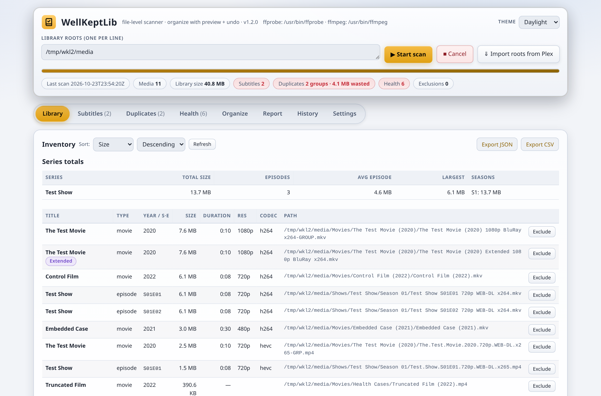

# WellKeptLib

**A file-level keeper for your media library.** WellKeptLib scans
the folders your media actually lives in and tells you what's
wrong with the *files* — then helps you fix the layout. It works
on disk, not through a media-server API: every core tool works
with no Plex connection at all. (An optional Plex sign-in exists,
and only saves you typing folder paths.)

One static binary. No runtime, no database server, no Docker.
It runs as a small local web app: a service on your server, a
double-click `.exe` on Windows.

- **Version:** 1.3.3
- **License:** MIT (see [LICENSE](LICENSE))
- **Platforms:** Linux x86-64, Linux ARM64, Windows x86-64
- **Dependencies:** Go standard library only (no third-party
  packages); ffmpeg/ffprobe at runtime for media probing

## Screenshots

Taken from a running 1.2.0 instance (the UI is unchanged in
1.3.3 apart from extra bottom clearance when the Ko-fi
button is drawn; 1.3.2 added the Settings Support card;
1.3.0 added one button) over a small synthetic
demo library (the same generated fixture library the tests
use — no real collection is shown). All shots use the
default Midnight theme except the last, which shows
Daylight — one of six built-in themes (new in 1.2.0).

**Library — inventory by size, per-series totals:**


**Duplicates — identity groups with keeper ranking and
reclaimable-vs-apparent space:**


**Subtitles — declared vs. detected language, with the
evidence lines, plus coverage:**


**Health — empty, corrupt, and incomplete files, each with
its probe evidence:**


**Report — the library report card (also downloadable as
CSV / standalone HTML):**


**Organize — the hardlink library plan preview: links to
create, collisions, and skips, before anything is written:**


**The same library in the Daylight theme:**


## What it does

- **Duplicates, by identity — not by bytes.** Finds the same
  movie or episode stored more than once even when the copies
  differ in codec, resolution, or size (a 1080p x264 and a 720p
  x265 of the same episode are one group). Editions (Extended,
  Director's Cut, …) are kept separate. Groups show total wasted
  space, per-copy resolution / codec / bitrate / HDR / duration,
  a suggested keeper — and guarded per-copy delete (never a
  group's last copy, always logged). **Hardlink-aware:**
  copies that are hardlinks to the same physical file are
  identified as such (device/inode captured during the scan),
  and the group shows *reclaimable* space — what deleting
  copies would actually free — next to the apparent figure;
  when a file's identity can't be determined, the figure is
  honestly labeled an estimate.
- **Subtitle truth-checking.** Subtitle files and embedded
  tracks are checked against their *text*, not their labels: a
  track tagged English whose cues are actually Spanish is
  flagged, with the detected language, a confidence value, and
  sample lines as evidence. Image-based tracks (PGS/VobSub)
  are reported as "cannot verify", never guessed. The
  embedded-track audit can be switched off in Settings.
  A guided **subtitle wizard** works through the findings:
  dismiss ones you've reviewed (dismissals are bound to the
  file's fingerprint, so a changed file resurfaces), relabel
  a mislabeled sidecar (with undo), delete a bad sidecar
  (guarded), and fill gaps by downloading from OpenSubtitles
  (see below).
- **Library health.** Empty and truncated files, unparseable
  containers, missing video streams, broken subtitles, and
  leftover download artefacts (`.part`, `.crdownload`, …) —
  each finding carries the probe evidence that caused it.
  Findings have guarded per-file actions (open location,
  delete) with an audit log.
- **Inventory by size.** Movies, series, and seasons sorted
  by size, per-root totals, biggest files overall.
- **Missing episodes.** A gaps view lists episodes that are
  absent between the ones you have, per series and season.
- **Subtitle coverage.** Per-show / per-library coverage for
  the languages you want (a persisted wanted-languages list):
  which episodes have which languages, and which are missing.
- **Folder hygiene.** Orphan sidecar files (subtitles, .nfo,
  artwork with no video beside them) and empty folders,
  listed for review.
- **Report card + export.** A Report tab aggregates the whole
  library (summary, duplicates, findings, coverage, gaps),
  downloadable as a sectioned CSV or a self-contained HTML
  page (no scripts, no external references).
- **Scan history.** Every completed scan is recorded (up to
  50) with a delta against the previous one — added, removed,
  and changed files — with missing roots handled honestly
  (a root that wasn't scanned is never reported as mass
  deletions).
- **Scheduled scans + webhook.** Optional in-process
  scheduled rescans (every N hours, or daily at a set time;
  the app must be running) and an optional scan-finished
  webhook (generic JSON, Discord, or ntfy flavor) whose
  payload carries counts only — never paths or credentials.
  Delivery is fire-and-forget: a dead webhook can never fail
  or delay a scan.
- **One-shot CLI mode.** `-scan-once` runs a scan from the
  command line (optionally writing a report file), with
  script-friendly exit codes: 0 = completed, 1 = scan failed,
  2 = configuration error (including "another instance is
  using this data folder"), 3 = only with `-fail-on-findings`,
  when a completed scan found reclaimable duplicates or
  health problems.
- **Link-plan problems export (1.3.0).** In link mode, once
  a plan exists, **Export problems (JSON)** downloads the
  plan's full diagnostics (`wellkeptlib.linkplan.diagnostics`,
  schema v1): every collision with all its sources, the
  keeper pick *and its reasoning* (per-source parsed identity
  + probe facts — resolution, HDR, bitrate, size, duration;
  duration-gated groups export the keeper as an explicit
  `null` with the reason), every target conflict with the
  occupying file's facts, every unidentified file with the
  planner's exact reason, and every unlinkable file with its
  cause. Healthy categories are counts-only, and the
  document's own `notes` field says so. Exporting is
  read-only — it never consumes the plan. It's built for
  handing a real tree's problems over for bulk analysis.
- **Themes + an app icon (1.2.0).** Six built-in color
  themes (Midnight default, Daylight, Ocean, Ember, Forest,
  Plum) from the header menu or Settings → Appearance,
  persisted server-side and applied without a reload flash —
  plus a proper favicon / touch-icon set (before 1.2.0 the
  app served no icon at all).
- **OpenSubtitles downloads (optional, your own key).** The
  wizard can search OpenSubtitles and download a missing
  subtitle beside the media file (never overwriting; the
  downloaded file is language-checked by the app's own
  detector before placement and the verdict is shown).
  Bring your own free OpenSubtitles API key, stored locally
  (see Transparency). Downloads use your own account login
  and the quota the API itself reports — nothing is
  hardcoded. **Honest status: this client is verified
  against a mock of the documented API shapes, not yet
  against the live API** — see Known limitations.
- **Organize into Jellyfin folders.** Pick a messy folder and
  preview a full Jellyfin-layout plan (`Title (Year)/…`,
  `Series/Season 01/Series - S01E01 - Title.ext`) before
  anything moves. Apply re-validates the tree, writes an undo
  manifest *before* the first move, and Undo restores the exact
  original layout — weeks later, if you like. Unidentified
  files are left in place and listed with reasons; collisions
  are flagged, never overwritten.
- **…or build the library as hardlinks (new in 1.1.0).** A
  second Organize mode builds the same Jellyfin layout under
  a destination folder you choose as **hardlinks** to the
  untouched originals: your existing folders (and any seeding
  paths) stay exactly as they are, and the new library costs
  no extra disk space. The preview proves feasibility up
  front from the scan's device/inode data and sorts every
  file: links to create, already linked (re-running a build
  is a no-op), collisions (the keeper is picked by the same
  ranking as Duplicates — resolution → HDR → bitrate → size;
  copies whose durations suggest different cuts are left
  **unresolved**, never auto-linked), unidentified files,
  unlinkable files (cross-device or unknown identity, with
  the reason), and target conflicts — a real file already at
  a target is never overwritten or deleted. Apply writes its
  manifest first and creates directories + links only. Undo
  removes only links that still point at the recorded
  source; a target you replaced with a real file is skipped
  and reported. Keep the destination **outside** your scan
  roots (the UI warns when it isn't) so the linked copies
  don't show up as duplicates of themselves. Hardlinks need
  source and destination on the **same filesystem**, and
  deleting an original doesn't free space while a link to it
  remains — both stated in the UI.

Scanning is always read-only. The only features that touch
files are Organize (preview → apply → undo; the link mode
creates hardlinks in the destination folder only — sources
are never modified, and its undo verifies each link still
points at the recorded source before removing it), the
guarded per-file deletes on the Health and Duplicates tabs,
and the subtitle wizard's guarded actions (relabel with
undo, delete, and placing a downloaded subtitle beside its
media file — never overwriting). File-changing actions
validate against the current findings and write audit logs
in the data folder (`deleted-actions.json`,
`subtitle-actions.json`, `subtitle-manifests/`,
`link-manifests/`).

## Install

Get `WellKeptLib-1.3.3-public.zip` from the
[Releases](../../releases) page and extract it. The package
contains the three binaries, `install.sh`, and the two install
guides ([INSTALL-ULTRA.md](INSTALL-ULTRA.md),
[INSTALL-WINDOWS.md](INSTALL-WINDOWS.md)).

### Linux server (seedbox, home server, VPS)

```sh
# extract the release zip, then:
./install.sh
```

The installer asks for a port and a bind mode, installs the
binary to `~/bin`, writes a user systemd service, starts it,
and verifies the app actually answers before declaring success.

- **proxy mode** (default): listens on `127.0.0.1` only, for a
  reverse proxy (nginx/Caddy) in front — on Ultra.cc-shaped
  hosts (a `~/.apps/nginx/proxy.d` directory) it writes the
  nginx snippet for you; elsewhere it prints the snippet.
- **lan mode**: listens on the network directly. Read the
  security warning below first.

The same script **updates** an existing install (timestamped
binary + config backups, version check after the swap,
automatic rollback if the new binary doesn't come up) and
**uninstalls** with `./install.sh --uninstall` (your data
folder is kept unless you explicitly say otherwise). No sudo
is used anywhere. Manual steps, if you prefer them, are in
[INSTALL-ULTRA.md](INSTALL-ULTRA.md).

The final address on a proxied host is
`https://<your-slot-hostname>/plex-file-manager`. First run:
type your library folders into **Library roots** (one per
line), click **▶ Start scan**, and browse the tabs.

### Windows

1. Extract the ZIP to a folder you keep.
2. Double-click `plex-file-manager.exe` — a console window
   opens and stays open; that window is the app running.
   SmartScreen may warn (the exe is unsigned): **More info →
   Run anyway**.
3. Your browser opens at `http://127.0.0.1:8787/`. Add your
   library folders, click **▶ Start scan**.

Full click-by-click, including the ffmpeg fix and the
command-line flags (`-addr`, `-data`, `-baseurl`,
`-no-browser`), is in [INSTALL-WINDOWS.md](INSTALL-WINDOWS.md).

### Requirements

- **ffmpeg / ffprobe** on the machine (the app probes media
  with them). The installer offers a static build if they're
  missing; on Windows, dropping `ffprobe.exe`/`ffmpeg.exe`
  next to the app works too. Paths can be set in Settings —
  use full paths, `~` is not expanded there.
- A free port you control. On a seedbox, use one from your
  assigned range.

## ⚠ Security: there is no login

WellKeptLib has **no authentication of its own** — anyone who
can reach its port can use it, including Organize and the
guarded deletes. Run it behind a reverse proxy with basic
auth (a 3-step recipe is in
[INSTALL-ULTRA.md](INSTALL-ULTRA.md)), or keep it on
`127.0.0.1` / a trusted LAN only. Don't expose the bare port
to the internet.

## Transparency: privacy, network, and data

- **No telemetry, no analytics, no accounts.** The app never
  phones home. All scanning and analysis happens locally.
- **Network calls happen only when you ask for them:**
  contacting plex.tv during the optional Plex sign-in, talking
  to your own Plex server after you connect it, calling the
  OpenSubtitles API when you've configured it and use the
  wizard's search/download, posting to the webhook URL *you*
  configured when a scan finishes, and — if you accept the
  installer's offer — downloading a static ffmpeg build.
- **Your data stays in one folder** (`~/.local/share/plex-file-manager`
  on Linux, `%LOCALAPPDATA%\PlexFileManager` on Windows):
  settings, scan cache, exclusions, organize undo manifests,
  and the delete audit log. It survives updates and is never
  touched by the installer except a timestamped backup of
  `config.json` during an update.
- **Plex tokens:** the connected server's token is stored in
  `plex.json` in the data folder (permissions 0600 on Linux) —
  treat it like a password. Your plex.tv *account* token is
  kept in memory only, unless you explicitly tick "Remember my
  sign-in", in which case it is stored in that same file. No
  token is ever returned by any API response.
- **OpenSubtitles credentials:** if you configure them, your
  API key and account login live in `opensubtitles.json` in
  the data folder (permissions 0600), on the same pattern.
  Every API surface returns *presence only* (configured /
  logged-in) — never the key, password, or session token; a
  dedicated test plants secrets and sweeps the settings,
  diagnostics, state, config, and report outputs for leaks.
- **This repository is the complete source** of the shipped
  1.3.3 binaries. Four disclosed divergences — in test files,
  one default, and one UI clearance fix: the fixture lookup helper
  additionally accepts this repository's fixtures layout,
  and the fixture generator script ships in `fixtures/`;
  the bulk parser regression in `bulk_export_131_test.go`
  skips in a standalone clone (its corpus is a real export,
  not shipped here) and runs in full where the verification
  copies exist — the two fractional-misfire victims it
  covers are also pinned verbatim in `parser_131_test.go`;
  and the Ko-fi username default is **carried as-is**
  in this public edition by explicit owner decision
  (2026-10-23), as a scoped exception to the scrub rule
  for this one default value only: donations from public
  users therefore go to the maintainer, and the button
  works out of the box. The UI placeholder stays generic;
  and the Ko-fi clearance fix in `web/index.html` (extra
  bottom padding plus lifting the Duplicates batch bar and
  the back-navigation toast while the floating button is
  drawn, so it can never cover content) originates in this
  public edition. No other product code or test assertion
  differs from
  the development tree, and every other scrub item still
  applies in full. The public
  edition was produced from a
  private codebase by a scripted scrub gate: a denylist
  (personal names, usernames, hostnames, domains, private
  connection details) is grepped over the whole tree *and* the
  binary string tables, and the release only ships at zero
  hits, verified again on the extracted release ZIP.

## How it works (briefly)

- The scanner walks your roots, parses filenames into
  identities (title + year for movies; series + season/episode
  for TV, with common release tags stripped), and probes each
  file once with ffprobe; probe results are cached, so later
  scans are fast, and the cache is saved as a scan runs.
- Duplicate detection compares parsed identities (with
  duration as a confirmation signal and exact-hash as a
  sub-type), not file bytes alone — that's why different
  encodes of the same episode group together.
- Subtitle language detection reads the subtitle text itself
  (stopword scoring for Latin-script languages, script-based
  defaults for others — e.g. Cyrillic defaults to Russian;
  that is a default, not a detection) and compares it with
  the filename/stream language tag.
- The web UI is a single HTML file embedded in the binary;
  the plumbing names (binary, service, data folder, base URL)
  use the project's original `plex-file-manager` naming and
  stay stable so existing installs update in place.
  WellKeptLib is the product name.

## Building from source

Stdlib-only Go — no third-party dependencies. With Go 1.23+
installed:

```sh
go build -trimpath -o plex-file-manager .
bash fixtures/generate.sh   # synthetic test library (needs ffmpeg)
go test ./...
```

The release binaries are built exactly like this
(`CGO_ENABLED=0`, `-trimpath`):

```sh
CGO_ENABLED=0 GOOS=linux   GOARCH=amd64 go build -trimpath -o plex-file-manager .
CGO_ENABLED=0 GOOS=linux   GOARCH=arm64 go build -trimpath -o plex-file-manager-arm64 .
CGO_ENABLED=0 GOOS=windows GOARCH=amd64 go build -trimpath -o plex-file-manager.exe .
```

## Verification (what was actually checked for 1.3.3)

- Go test suite: **282 top-level tests, all passing**,
  counted as `--- PASS` lines from `go test -v ./...` and
  re-run on this published tree (282 PASS, 0 FAIL);
  `go vet` and `gofmt` clean. No pre-existing test
  expectation changed (278 carried + 4 new zero-size
  link tests; the central one fails on the 1.3.2 base).
- Page checks: 162 ids looked up / 187 defined, all resolve;
  the Node render harness passes **128/128** online (stub
  CDN seam), with offline / blank / disabled scenarios
  green as well.
- Shipped-binary smoke: **91/91** — the full carried
  battery (baseline 11/2/2/6, incident replay, link mode,
  themes, icons, report/exports, CLI codes, the 1.3.0
  export, the 1.3.1 keeper-evidence checks, the 1.3.2
  Ko-fi checks) plus 4 new 1.3.3 checks over HTTP: the
  plan selects a 0-byte episode and records its size as
  0, the file then grows with identity and recorded
  mtime restored, and Apply still creates the link with
  target identity equal to the source's. The public
  package's extracted binary passes the same smoke, and
  the installer walk passes **12/12** (with the honest
  limit that `systemctl` is shimmed in the sandbox
  walks).
- Standalone clone proof: a clean copy of this tree,
  with fixtures generated by the shipped
  `fixtures/generate.sh`, passes `go test ./...` —
  **281 PASS, 0 FAIL, 1 SKIP** (the bulk regression,
  which needs the unshipped real-export corpus; see the
  transparency note).
- **Ko-fi clearance, measured:** with the widget's real
  CSS and script served locally (the build VM cannot
  reach the CDN from a browser), the floating button
  measures 180×65 px at 16 px from the bottom-left,
  top edge 81 px from the viewport bottom. After the
  fix, all 8 tabs at max scroll show **zero overlaps**
  at 1280 px and 360 px viewports, and the Duplicates
  batch bar sits at bottom: 92 px while the button is
  drawn.
- **Default-theme equality, measured:** a headless-Chrome
  computed-style probe of 17 chrome elements against a
  running 1.1.1 binary and the 1.2.0 default found them
  identical everywhere — Midnight is the old look,
  pixel-for-pixel, not an approximation. The same probing
  caught (and fixed) two theme defects before shipping.
- **Contrast, measured:** body and muted text pass WCAG AA
  on all six themes. One disclosed miss: the tertiary
  "faint" text (table headers, sample lines, empty states)
  measures 3.34–4.00 : 1 on the five dark themes — a
  pre-existing property of the original design, kept
  deliberately so the default theme stays pixel-identical;
  Daylight passes at 5.04 : 1.
- Scrub gate over the extracted release ZIP (tree + binary
  strings): **exactly one hit, allowlisted** — the
  carried Ko-fi username default (see the transparency
  note above), present in `internal/core/config.go` and
  in the three binaries. Everything else on the full
  denylist (personal names, usernames, hostnames,
  domains, private connection details, and
  cross-references to other private projects) is zero.
- ARM64: the binary is built and file-type verified, but it
  has **not** been run on real ARM hardware by us — reports
  welcome.

## Known limitations

- No built-in authentication (see the security warning).
- **Theme choices are verified in headless Chrome, not yet
  on real installs** — theme picking, the no-flash reload,
  and the tab icon on real machines are pending the
  maintainer's live test, as is the 1.1.1 Windows lock fix
  below.
- **The Ko-fi button is not yet live-proven in a
  browser.** The loader URL was fetch-checked (HTTP 200,
  genuine overlay script), the page wiring is proven
  with a stub CDN in the render harness, and the
  button's size and position were measured from its real
  assets in headless Chrome (the 1.3.3 clearance fix is
  built on those measurements) — but a real browser load
  of the floating button is pending the
  maintainer's own browser test. The public default is
  the maintainer's handle by owner exception, so the
  button works out of the box; blanking the field still
  disables it entirely.
- **The 1.3.3 zero-size link fix is fixture-proven.** The
  four new tests and the shipped-binary smoke cover the
  recorded-0 cases end to end (plan → apply → undo), and
  the key test fails on 1.3.2 as expected. The live
  proof — applying a link build on a real tree whose
  files report size 0 — is the maintainer's.
- **The problems export has now seen a real tree — and
  1.3.1 is the result.** The first real link-problems
  export surfaced both defects fixed here. Honest boundary:
  the exact walk-stat-zero mechanism on that tree was not
  reproduced locally; the fix guarantees ranking never
  consumes a zero any in-process source can replace, and
  the maintainer's re-run with a corrected destination is
  the live proof — the next export should show real sizes
  and probe facts on the affected groups.
- **The 1.1.1 Windows lock fix is not yet live-proven on
  Windows.** The bug it fixes was confirmed live (a real
  lockout, cleared by hand-deleting the lock file), and the
  fix's takeover logic is proven by regression tests and an
  incident replay on Linux, where the logic is shared — but
  the Windows liveness check and console-close handler
  themselves are compile-verified and logic-reviewed only;
  they cannot execute in the build environment. The first
  Windows start after an unclean close is the live proof.
- **The hardlink library mode is not yet live-proven.**
  Real cross-device (EXDEV) failures and Windows hardlink
  execution are verified at an injected-function test seam
  — they cannot execute in the build environment — and the
  mode has not yet had a live run on real hardware (the
  maintainer's own slot/Windows test is pending). The Linux
  same-filesystem path is fully test- and smoke-proven,
  including the source-untouched invariant. Hardlinks also
  inherently require source and destination on the same
  filesystem, and a destination inside your scan roots makes
  linked copies appear as duplicates (the UI warns).
- **OpenSubtitles is not yet live-verified.** No real API key
  was available in the build environment, so the client is
  verified against a mock implementing the documented
  request/response shapes. A few live response shapes aren't
  pinned byte-for-byte (the search list key, exact quota field
  names, download-link header expectations); the parser is
  deliberately tolerant, and quota figures are read from the
  API's own responses, never hardcoded. If you try it with a
  real key, issue reports are very welcome.
- Scheduled scans run inside the app process — the app must
  be running for a schedule to fire. Missed slots are not
  queued; the next slot is consumed once when the app next
  runs.
- Image-based subtitle tracks (PGS/VobSub) can't be
  language-verified.
- Subtitle language detection is heuristic: short files and
  languages sharing a script can be misjudged; findings show
  their evidence so you can decide.
- A first scan of a very large library takes a while (every
  file is probed once). Raise **Probe workers** in Settings
  if it's slow; later scans reuse the cache.

## Release notes — 1.3.3

- **A file measured as 0 bytes still gets its hardlink.**
  Link plans never had a size gate, but applying one did:
  each entry is re-checked against the preview, and a size
  recorded as 0 counted as "changed" if the file measured
  at its real size at apply time, so that entry's link was
  skipped as source-changed. On some servers, whole packs
  report size 0 to every stat the app makes (while device
  and inode from the same stat read fine) — exactly the
  files this blocked. A recorded 0 now means "size
  unknown": a size difference alone never refuses the
  link, while identity (device + inode) and modification
  time still guard exactly, and files with a real recorded
  size keep the exact size check. Link manifests written
  by older versions get the same treatment. Proven by four
  new tests — including one that fails on 1.3.2 — and by
  the shipped-binary smoke. Live proof (applying a link
  build on a tree that reports size 0) is still the
  maintainer's.
- **The Ko-fi button can no longer cover content.** The
  floating button is 180×65 px, fixed 16 px from the
  bottom-left (its position is set by the widget, not
  configurable). The page's bottom padding is now 120 px
  on desktop and narrow screens alike, and while the
  button is actually drawn — only then — the Duplicates
  batch bar and the back-navigation toast lift above it.
  Offline, disabled, or blank-username pages get no layout
  shift at all. Measured with the widget's real assets in
  headless Chrome: zero overlaps across all 8 tabs at max
  scroll, desktop and narrow viewports. This clearance
  fix originates in the public edition (see the
  transparency note above).
- Carries everything from 1.3.2 and 1.3.1 (1.3.1 was
  never released separately on the public line). Nothing
  else changes: no plan, ranking, export, or manifest
  changes.

## Release notes — 1.3.2

- **Ko-fi Donate button, online only.** Settings gains a
  Support card: a "Show Ko-fi Donate button" toggle (on by
  default) and a Ko-fi username field. Toggle ON + username
  set + online → one async script load on page load draws
  the floating Donate button (floating-chat, "Donate",
  #323842 background, white text). Toggle ON + offline or
  CDN unreachable → silent absence, no error, no retry,
  every tab works as before. Toggle OFF → no script
  request at all, whatever the connection. Blank username
  → disables entirely, same as OFF. A change takes effect
  on the next page load; both keys survive restart and
  tuning reset, presence-aware on load and save.
- **Public edition difference, stated plainly:** the
  username default is carried as-is here, by explicit
  owner decision (2026-10-23), as a scoped exception to
  the scrub rule for this one default value only.
  Donations from public users therefore go to the
  maintainer, and the button works out of the box. A
  user who wants a different account edits the field;
  blank disables the button entirely. Every other
  identifying item is still scrubbed as usual.
- Nothing else changes: no other UI, scan, link, or
  behavior changes beyond the Support card and the two
  new config keys.

## Release notes — 1.3.1

- **Link-plan keeper picks now use real evidence.** A
  collision whose copies had never been probe-scanned could
  be ranked on empty facts — the export literally said
  "0 bytes" — and fall to path order. The ranking now
  takes a probe size where one exists, fills a zero size
  from the walk stat, retries a still-zero size with a
  fresh stat at decision time, and no longer lets a
  scan record carrying no ranking facts at all
  short-circuit the resolver: it falls through to a live
  probe. The pick order itself is unchanged
  (resolution → HDR → bitrate → size, path-order
  tiebreak).
- **Fractional episodes narrowed.** A decimal now counts
  as a half-episode only when it is attached directly to
  the episode token (S22E21.5). Titles that merely start
  with digits or contain a decimal — "500 Keys"
  (Simpsons S22E21), "Level 5.5" (One Piece absolute
  438) — no longer wipe the episode number. Genuine
  half-episodes still work as before.
- Bulk regression: the fixed parser was run over every
  basename in the first real export (843 basenames); the
  two victims above flipped to their corrected
  identities and there were **0 unexplained deltas** —
  that check now lives in the suite and fails on any
  future delta outside the two victims.
- Nothing else changes: no UI changes, no new settings,
  files, or persistence surfaces.

## Release notes — 1.3.0

- **Export the link plan's problems as JSON.** One new
  button in Organize → link mode downloads the complete
  diagnostics document for a plan: collisions with keeper
  reasoning and per-source facts, target conflicts with the
  occupant's facts, unidentified files with exact reasons,
  unlinkable files with causes — healthy files as counts
  only, disclosed in the document itself. Read-only; the
  plan stays applicable afterwards. Built for handing a
  real tree's problems over for analysis.
- Nothing else changes: planner outcomes are identical to
  1.2.0 (the export only snapshots more of what the planner
  already knew), and there are no new settings, files, or
  persistence surfaces.

## Release notes — 1.2.0

- **Theme selector — pick your colors.** Six themes:
  Midnight (the original look, still the default), Daylight,
  Ocean, Ember, Forest, Plum. Pick from the header menu or
  the Settings → Appearance swatch tiles; the choice applies
  instantly, is stored on the server (it follows you across
  browsers and survives the settings tuning reset), and is
  applied before first paint on reload — no flash of the
  wrong theme. Midnight was verified pixel-identical to the
  pre-theme UI by a computed-style probe.
- **An app icon at last.** A book-with-a-check on the app's
  amber gradient (Lucide `book-check`, ISC licensed),
  embedded in the binary and served as favicon.svg / .ico /
  PNG / apple-touch-icon — 1.1.1 and earlier returned 404
  for `/favicon.ico`; 1.2.0 serves the full set. The same
  mark sits beside the title in the header.
- Carries the 1.1.1 Windows lock hotfix. No scan, link,
  organize, wizard, API (beyond the one new `theme` config
  key), or behavior changes otherwise.

## Release notes — 1.1.1 (hotfix; supersedes 1.1.0)

- **Windows startup lockout fixed.** In 1.0.0–1.1.0, the
  single-instance lock in the data folder could never be
  recognized as stale on Windows, and closing the app window
  never released it — so after the first close, every later
  start exited immediately claiming another copy was running.
  1.1.1 checks process liveness for real, releases the lock
  when the window closes, and treats a lock left by a dead
  process as stale. **If 1.1.0 locked you out, just start
  1.1.1** — it clears the dead lock itself; nothing needs
  deleting by hand (deleting
  `%LOCALAPPDATA%\PlexFileManager\app.lock` also works).
- The 1.1.0 public release has been **withdrawn** — please
  use this build instead. Nothing else changes: no new
  features, no UI changes, no behavior changes beyond the
  fix and the version number.

## Release notes — 1.1.0

- **Organize gains a hardlink mode:** build the Jellyfin
  layout as hardlinks under a separate destination folder;
  originals are never touched (proven by full-tree snapshots
  in tests and smoke). Preview classifies every file
  (create / already-linked / collision with keeper ranking /
  unresolved / not-identified / unlinkable / target-conflict),
  Apply is manifest-first and incremental, Undo removes only
  links still pointing at their recorded source.
- Symlink fallback was considered and rejected: links would
  rot when sources move, and several players resolve
  symlinks inconsistently. Hardlinks keep every path real.
- No other changes: scanner, duplicates, subtitles, reports,
  scheduler, webhook, and CLI behavior are identical to
  1.0.0, and every pre-existing test passes unmodified.

## Release notes — 1.0.0 (changes since 0.7.0)

- **Hardlink truth in Duplicates:** reclaimable vs apparent
  space, hardlink copies flagged, estimates labeled.
- **Report tab** with sectioned CSV and self-contained HTML
  export, numbers guaranteed equal to the app's own API.
- **Scan history** (last 50) with per-scan deltas and
  missing-root-safe comparisons.
- **Scheduled scans** (interval or daily, in-process) and a
  **scan-finished webhook** (generic / Discord / ntfy,
  counts-only payload).
- **CLI mode:** `-scan-once` with documented exit codes and a
  data-folder lock shared with the server (a second instance
  refuses cleanly instead of corrupting state).
- **Subtitle wizard, complete:** overview, fingerprint-bound
  dismissals, relabel with undo, guarded delete, coverage and
  gap views, and OpenSubtitles search/download with your own
  API key (mock-verified; see limitations).
- **Missing episodes, subtitle coverage, folder hygiene**
  (orphan sidecars, empty folders).
- **Embedded-subtitle audit toggle** in Settings (it can
  finally be switched off; off means off — no extraction, no
  embedded findings).
- 0.7.0 brought: `install.sh` (install / update-with-rollback
  / uninstall on any Linux server), the ARM64 build, and the
  WellKeptLib name (display surfaces only; plumbing names
  unchanged, existing installs update in place).

## License

MIT — see [LICENSE](LICENSE). Copyright (c) 2026
WellKeptLib contributors.
